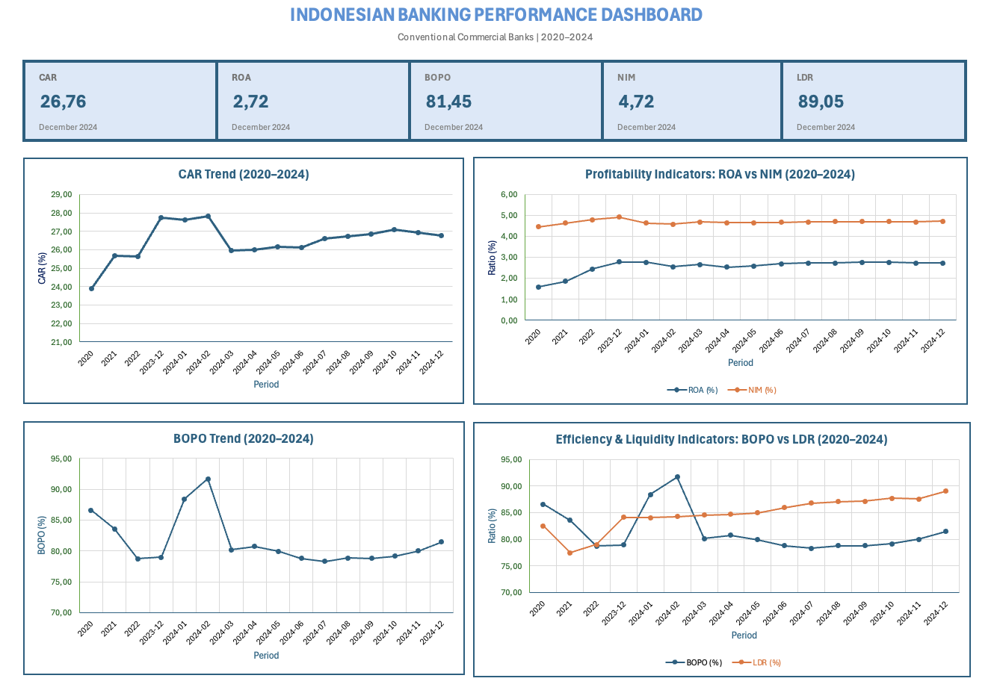

# Indonesian Banking Industry Performance Analysis

An Excel-based analysis of the performance of Indonesia's conventional commercial banks from 2020 to December 2024, using five key financial ratios: CAR, ROA, BOPO, NIM, and LDR.

## Objective

To analyze capital adequacy, profitability, operational efficiency, and liquidity of Indonesia's conventional commercial banking industry, and to identify performance patterns and changes over the observed period.

## Data

- **Source:** OJK (Otoritas Jasa Keuangan), Indonesian Banking Statistics, December 2024
- **Scope:** Conventional Commercial Banks (excluding Islamic Commercial Banks / BUS)
- **Period:** 2020 – December 2024
- **Observations:** 16 data points (annual 2020–2022, December 2023, and monthly January–December 2024)
- **Raw tables used:** Commercial Bank Operations (1.1.a), Income Statement (1.6.a), Bank Performance (1.16.a), Earning Assets and Credit Quality (1.23.a), Composition of Third Party Funds (1.28.a)

## Indicators

| Indicator | Meaning | Dimension |
|---|---|---|
| CAR | Capital Adequacy Ratio | Capital adequacy |
| ROA | Return on Assets | Profitability |
| BOPO | Operating Expenses / Operating Income | Operational efficiency |
| NIM | Net Interest Margin | Interest margin |
| LDR | Loan to Deposit Ratio | Liquidity / intermediation |

## Workbook Structure

| Sheet | Description |
|---|---|
| Raw_* (5 sheets) | Original OJK tables |
| Cleaned_Data | Structured dataset of the five ratios |
| Analysis | Descriptive statistics, initial vs. final change, key findings |
| Pivot_Analysis | Pivot summaries and chart data |
| Dashboard | KPI cards and trend charts |
| Business_Report | Findings, business implications, and recommendations |

## Methods

- Data cleaning and consolidation of raw OJK tables into a structured Excel table
- Descriptive analysis: average, minimum, maximum, range, and period of min/max
- Initial vs. final value comparison (absolute and percentage change)
- Pivot Table analysis and Excel dashboard
- Formulas used: XLOOKUP, INDEX, AVERAGE, MIN, MAX

## Key Findings

| Indicator | 2020 | Dec 2024 | Notes |
|---|---|---|---|
| CAR | 23.89% | 26.76% | Peaked at 27.83% in Feb 2024 |
| ROA | 1.59% | 2.72% | Peaked at 2.78% in Dec 2023 |
| BOPO | 86.58% | 81.45% | Highest 91.68% (Feb 2024), lowest 78.32% (Jul 2024) |
| NIM | 4.45% | 4.72% | Dipped to 4.58% in Feb 2024, then stable at 4.65–4.72% |
| LDR | 82.54% | 89.05% | Highest value in Dec 2024 |

- Capital adequacy, profitability, and operational efficiency improved compared with 2020.
- NIM dropped briefly in early 2024 before stabilizing.
- LDR trended upward, showing stronger credit intermediation, but a higher LDR may reduce liquidity flexibility and should be monitored.

## Recommendations

1. Maintain sufficient capital to absorb potential risks.
2. Optimize asset utilization to sustain profitability.
3. Keep monitoring operating expenses and income to maintain efficiency.
4. Monitor interest income and expenses to keep NIM stable.
5. Balance credit expansion with third-party fund management to protect liquidity.

## Limitations

- The data does not have a consistent frequency (annual for 2020–2022, monthly from December 2023), so period comparisons are indicative rather than a strict monthly trend.
- The analysis is descriptive and does not establish causal relationships.
- Ratios cover conventional commercial banks only.

## Tools

Microsoft Excel (Structured Tables, Pivot Tables, XLOOKUP, Dashboard)

## Author

Istiqomah — [LinkedIn](https://linkedin.com/in/istiqomah23) | [GitHub](https://github.com/Isti23)
